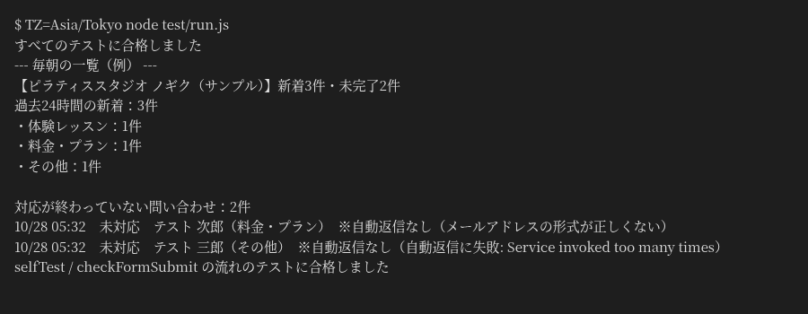

# 問い合わせフォームの受付・返信・記録の自動化（Google Apps Script）

小さな店の問い合わせ担当者向け。Google フォームに届いた問い合わせを、シートへの記録と受付の自動返信まで送信時に済ませ、朝8時に未対応の一覧を1通のメールで届けます。



上の画像は、Google のサービスを偽物に置き換えた模擬環境で `node test/run.js` を実行したときの実際の出力です（店名・人物は架空）。本物の Google アカウントでの画面はまだありません。

変わること：問い合わせを手でシートに写して返信していた作業が、フォーム送信と同時の自動記録と自動返信になります。

## 処理の内容

1. フォームが送信されると、回答をスプレッドシートに1行追加します
2. 送信者に自動返信メールを送ります。メールアドレスの形式が正しくないときや送信に失敗したときは、返信せずに記録だけ残し、「メモ」列に理由を書きます
3. 記録の「状況」列は、プルダウンで「未対応」「対応中」「完了」から選びます。新しい問い合わせは「未対応」で入ります
4. 毎朝8時に、過去24時間の新着の件数（ご用件ごと）と、状況が「完了」になっていない問い合わせの一覧を、担当者に1通のメールで送ります。新着も未完了もない日は送りません

シートの列は「受付日時・お名前・メールアドレス・ご用件・お問い合わせ内容・自動返信・状況・メモ」です。

## ファイル

| ファイル | 内容 |
|---|---|
| `Code.gs` | 本体。先頭の `CONFIG` に店名・送信先・時刻などの設定をまとめています |
| `appsscript.json` | タイムゾーン（Asia/Tokyo）、V8 ランタイム、必要な権限 |
| `test/local_test.js` | Google のサービスを簡単な偽物に置き換えて、Node.js で処理を確かめるテスト |
| `test/gas_flow_test.js` | 同じく偽物を使って、`selfTest()` と `checkFormSubmit()` の流れを確かめるテスト |

## 主な関数

| 関数 | 役割 |
|---|---|
| `setup()` | フォーム、記録用のスプレッドシート、2つのトリガー（フォーム送信時・毎朝）を作る。作成済みなら作り直さず、トリガーだけ作り直す |
| `onFormSubmit(e)` | フォーム送信時に実行される。自動返信を送り、シートに記録する |
| `sendDailySummary()` | 毎朝8時に実行される。新着と未完了の一覧をメールで送る |
| `removeTriggers()` | このプロジェクトのトリガーをすべて削除する |
| `resetSample()` | 覚えているフォームとシートの ID とトリガーを消す。次の `setup()` で新しく作り直す |
| `selfTest()` | `setup()` を行い、シート・フォーム・トリガー・自動返信・毎朝の一覧を確かめて、項目ごとに OK / NG を実行ログに出す |
| `checkFormSubmit()` | `selfTest()` のあとにフォームから送った回答が、トリガーで記録され、自動返信が送られたかを確かめる |

Google のサービスを使わない部分（回答の読み取り、メールアドレスの判定、本文の組み立て）は別の関数に分けていて、Node.js でテストできます。

## 設定の手順

1. https://script.google.com/ で新しいプロジェクトを作ります
2. `Code.gs` の中身を貼り付けます
3. （任意）「プロジェクトの設定」で「appsscript.json マニフェスト ファイルをエディタで表示する」をオンにし、`appsscript.json` の中身を貼り付けます。貼り付けない場合、権限はコードから自動で判断されます
4. 必要なら `CONFIG` の店名・送信先（`ownerEmail`）・時刻を変えます。`ownerEmail` が空欄のときは、実行したアカウントに一覧が届きます
5. 関数の一覧から `selfTest` を選んで実行し、権限の確認画面ですべて許可します。フォームとシートとトリガーができ、実行ログに項目ごとの OK / NG が出ます
6. 実行ログに表示されたフォームの URL を開いて1件送信し、そのあと `checkFormSubmit` を実行します

スクリプトから送った回答では、フォーム送信時のトリガーは動きません（Google の仕様）。そのため `selfTest()` は処理を直接呼んで確かめ、トリガーそのものは手でフォームを送って `checkFormSubmit()` で確かめます。

自動返信は、スクリプトを実行したアカウントのアドレスから送られます。送信者名は `CONFIG.shopName` です。無料の Google アカウントでは1日に送れるメールの数に上限があります。

`setup()` や `selfTest()` をもう一度実行しても、フォームとシートは作り直しません。最初から作り直すときは、古いフォームとシートを削除してから `resetSample()` を実行してください。

確認が終わって毎朝の一覧が要らなくなったら、`removeTriggers()` を実行してください。

## テスト

```sh
node test/run.js
```

（local_test.js と gas_flow_test.js を順に動かします）

次のことを確かめています。

- 正しいアドレスには返信が1通送られ、記録の状況は「未対応」になる
- 形式の正しくないアドレスには返信せず、メモに理由が残る
- 送信に失敗しても記録は残り、メモに理由が残る
- 毎朝の一覧に、新着の件数・ご用件ごとの件数・未完了の問い合わせが入り、「完了」にしたものは入らない
- `selfTest()` がすべて OK になり、2回目の実行ではフォームとシートを作り直さない。実行ログにメールアドレスを出さない
- フォームから送る前の `checkFormSubmit()` は NG を出し、送ったあとは OK になる

現時点では、このローカルのテストで処理を確かめた段階です。Google上での動作は、手順5・6の selfTest と checkFormSubmit で確かめられます。

## 注意

- 店名・人物はすべて架空です。フォームには実際の個人情報を入力しないでください
- フォームの URL を公開すると、知らない人の送信にも自動返信が送られます。サンプルとして動かすときは、URL を公開しないでください

---

## English summary

A small Google Apps Script project for a contact form (fictional pilates studio):

- Google Form submission to a new row in a spreadsheet
- Instant auto-reply to the sender; invalid addresses and send failures are logged in a note column instead of stopping the script
- Status column with a dropdown (new / in progress / done)
- Summary email to the owner at 08:00 with new inquiries by topic and every inquiry not marked done

All settings are in the `CONFIG` object at the top of `Code.gs`. Run `selfTest()` to create the form, the sheet and the triggers and print OK / NG per check, then submit the form once and run `checkFormSubmit()` to confirm the submit trigger. Pure helper functions and the check flow are covered by Node.js tests with mocked Google services (`node test/local_test.js`, `node test/gas_flow_test.js`). It has been checked with these local tests only.

## 作りの工夫
- 二重処理の防ぎ方：setup() はフォームとシートが作成済みなら作り直さず、トリガーだけ作り直す（Code.gs の setup と openOrNull_）
- 6分制限：フォーム送信ごとの短い処理と、毎朝1回のまとめ（sendDailySummary）に分けている

## 作った人
Reypage｜GAS業務自動化

## ライセンス
MIT（LICENSE を参照）
